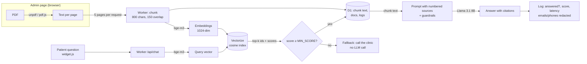

# Cosmo Dental Assistant: a RAG document Q&A chatbot

A bilingual (English/Spanish) assistant on [cosmodentalusa.com](https://www.cosmodentalusa.com) that answers patient questions **only from the clinic's own PDFs**, with a citation for every answer. When the documents don't cover a question, it says so and gives the clinic's phone number.

Built by Alaa Rajab. Runs on the **Cloudflare Workers free plan: $0/month** for the clinic.

**Stack:** TypeScript · Cloudflare Workers · Workers AI (bge-m3, Llama 3.1 8B) · Vectorize · D1 (SQL) · Vitest · **Python (pandas, matplotlib, Jupyter) for evaluation and tuning**



## How it works

| Step | Where | What I built |
|---|---|---|
| 1. Extract | Browser (`admin-src/extract.ts`) | PDF → text per page with `unpdf`. Runs client-side because free-plan Workers get ~10 ms of CPU per request. |
| 2. Chunk | Worker (`src/chunk.ts`) | Sentence-aware chunks of ≤800 characters with 150 characters of overlap. Chunks never cross pages, so citations can name the page. |
| 3. Embed | Worker (`src/rag.ts`) | `@cf/baai/bge-m3` (multilingual), batched 20 per call. Each chunk is prefixed with the document title for context. |
| 4. Store | Vectorize + D1 | Vectors go in Vectorize; chunk text and metadata go in D1, linked by the same id (`<doc>-p<page>-<n>`). |
| 5. Retrieve | Worker | Embed the question → top-5 cosine matches → drop matches below `MIN_SCORE` → load text from D1. |
| 6. Generate | Worker (`src/prompt.ts`) | `@cf/meta/llama-3.1-8b-instruct-fast`, temperature 0.2, numbered sources, strict rules (below). |
| 7. Measure | D1 + `eval/` | Every question logged anonymously (answered or not). An offline eval set reports accuracy, refusal rate and citation rate. |

### Guardrails
- Answers only from the sources. If they don't contain the answer, the model must output `NO_ANSWER`, and the Worker swaps that for a friendly "please call (708) 345-6313" message. This makes "unanswered" a measurable metric.
- If retrieval finds nothing relevant, **the LLM isn't called at all** (saves free-tier quota and removes any chance of a hallucinated answer).
- No diagnoses, medical advice or medication doses; for emergencies it says to call 911.
- The dentists are general dentists, and the bot is told never to call them specialists.
- Never asks for personal health information. Emails and phone numbers are redacted before questions are logged.
- Rate limit (10 questions/min per IP), 500-character max question, CORS restricted to the clinic's site, admin API behind a bearer token.

### Privacy
Only **clinic documents** go in (office info, aftercare instructions, insurance/payment FAQ, policies), **never patient records**. The free tier has no HIPAA Business Associate Agreement, so the admin page asks for confirmation on every upload.

## Project layout
```
src/index.ts        routes: /api/chat, /api/admin/*
src/rag.ts          embed, ingest, retrieve, generate, log
src/chunk.ts        chunking
src/prompt.ts       system prompt, guardrails, citation parsing
admin-src/          admin page logic + PDF extraction (bundled to public/admin.js)
public/admin.html   upload / delete documents, usage stats, unanswered questions
public/widget.js    dependency-free, accessible chat widget (EN/ES)
schema.sql          D1 tables
test/               unit + end-to-end tests (incl. experiment isolation) with in-memory fakes, plus a local mock server
eval/               evaluation questions + quick JS runner
experiments/        Python notebook: chunk-size, TOP_K and MIN_SCORE experiments
```

## Run it locally (no Cloudflare account needed)
```bash
npm install
npm test          # 18 tests: chunking, guardrails, PDF extraction, full ingest→answer flow
npm run mock      # http://localhost:8787/admin.html (token: test-token), widget at http://localhost:8787/
```
The mock uses a keyword-based fake "AI", so answers are rough. It's for testing the UI and the flow.

## Deploy to Cloudflare (free plan, no card)
Run these from this folder on your PC (PowerShell works):

```bash
npm install
npx wrangler login                     # sign in with the account that has access to the clinic's Cloudflare
npx wrangler vectorize create cosmodental-docs --dimensions=1024 --metric=cosine
npx wrangler d1 create cosmodental-assistant
#   → copy the database_id it prints into wrangler.jsonc
npm run db:init                        # creates the tables
npx wrangler secret put ADMIN_TOKEN    # paste a long random password (20+ chars)
npm run deploy                         # prints https://cosmodental-assistant.<subdomain>.workers.dev
```
If your login can see more than one Cloudflare account, add `"account_id": "<clinic account id>"` to `wrangler.jsonc`.

Then:
1. Open `https://<worker-url>/admin.html`, sign in with the token, and upload PDFs. `test/fixtures/office-info-SAMPLE.pdf` is a good first test.
2. Run the eval: `node eval/run-eval.mjs https://<worker-url>`.
3. Add the widget to the site (`index.html` in cosmodental_frontend, before `</body>`):
   ```html
   <script src="https://<worker-url>/widget.js" defer></script>
   ```
   Language is picked from `data-lang="es"`, else `<html lang>`, else a `/es/` URL.
4. Optional: give the Worker a custom domain such as `assistant.cosmodentalusa.com` (Worker → Settings → Domains & Routes).

### Free-tier budget
- Workers AI: 10,000 Neurons/day free. By Cloudflare's per-token prices, one answer with Llama 3.1 8B is roughly 10–50 Neurons, and questions stopped by the MIN_SCORE gate cost almost nothing. That's hundreds of questions a day; check the real number in the dashboard after a week.
- On the free plan, going over a limit makes requests **fail instead of billing**. The widget then shows "please call the clinic".
- Watch usage in Cloudflare → AI → Workers AI.

## Experiments (Python notebook)
`experiments/experiments.ipynb` tunes the pipeline with data instead of guesses:

1. Uploads the PDFs in `experiments/docs/` into **separate experiment namespaces** (`exp-c500`, `exp-c800`, `exp-c1200`), one per chunk size. The live assistant only searches `live`, so patients never see experiment data.
2. **Retrieval experiment (no LLM, nearly free):** hit@1/3/5/8 and MRR per chunk size, measuring whether the right page was retrieved.
3. **MIN_SCORE gate:** plots best-match scores for answerable vs out-of-scope questions and picks the threshold that separates them best.
4. **End to end:** answers every test question with the baseline and the tuned settings and compares accuracy, refusal rate, citation rate and latency.
5. Saves charts, CSVs and a `summary.md` for this README into `experiments/results/`.

```bash
cd experiments
python -m venv .venv && .venv\Scripts\activate      # macOS/Linux: source .venv/bin/activate
pip install -r requirements.txt
copy .env.example .env                               # then fill in WORKER_URL and ADMIN_TOKEN
jupyter notebook experiments.ipynb
```
`eval/questions.json` has 38 questions written from the clinic FAQ (30 answerable incl. 5 Spanish, 8 out of scope), each with `source_file` and `source_page`. Put `cosmo-dental-clinic-faq.pdf` in `experiments/docs/` (clinic PDFs are git-ignored). Add questions whenever you add documents. The notebook also runs against `npm run mock`, but the mock "AI" is keyword-based, so its numbers mean nothing.

Supporting Worker endpoints (admin token required): `POST /api/admin/ask` (custom `namespace`/`topK`/`minScore`, optional `retrieveOnly`) and `DELETE /api/admin/namespaces/exp-...`.

## Results
_Paste `experiments/results/summary.md` here after running the notebook on real clinic documents, then add live usage from the admin page: questions per month, % answered from documents, running cost $0._

## Roadmap
- Follow-up questions (rewrite the question using chat history before retrieval)
- Hybrid search (BM25 + vectors) and a re-ranker (`@cf/baai/bge-reranker-base`)
- Streaming responses
- OCR for scanned PDFs
- Sell it to other small clinics as a website add-on
