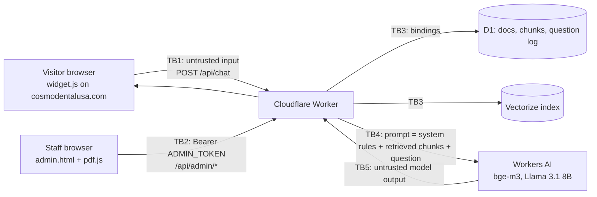

# Threat Model: Cosmo Dental AI Assistant

**System:** Bilingual RAG chatbot on cosmodentalusa.com (Cloudflare Worker + Workers AI + Vectorize + D1)
**Author:** Alaa Rajab · **Last reviewed:** 2026-11-13 · **Method:** STRIDE per trust boundary, mapped to OWASP Top 10 (2025) and OWASP Top 10 for LLM Applications (2025)

## 1. What we are protecting

| Asset | Why it matters |
|---|---|
| Clinic website availability and reputation | Live business site; a harmful or false answer is shown under the clinic's name |
| `ADMIN_TOKEN` | Full write access to the knowledge base (upload/delete documents) |
| Knowledge base (D1 `documents`/`chunks`, Vectorize vectors) | Everything the bot says comes from it |
| Question log (D1 `questions`) | Visitors may type personal or health information despite the warning |
| Free-tier AI quota | Exhausting it takes the assistant offline for the day (fails closed, no billing) |

Out of scope: patient records (never uploaded, by policy and an upload confirmation), the clinic's main website hosting, Cloudflare's own infrastructure.

## 2. Architecture and trust boundaries

| ID | Boundary | Trust change |
|---|---|---|
| TB1 | Visitor browser → Worker `/api/chat`, `/api/welcome` | Anonymous internet → our code. CORS limits browsers only, not curl. |
| TB2 | Staff browser → Worker `/api/admin/*` | Holder of a static bearer token → full KB write. PDF parsing happens in the browser, so the Worker receives already-extracted text. |
| TB3 | Worker → D1 / Vectorize | Platform bindings, no network credentials. Queries are parameterized. |
| TB4 | Worker → LLM | Trusted instructions and untrusted data (question + document chunks) are concatenated into one prompt. |
| TB5 | LLM → Worker → visitor | Model output is untrusted and is shown on the clinic's site. |

## 3. Threats, mitigations and residual risk

Likelihood/Impact: L/M/H. Status: ✅ mitigated · 🟡 partly mitigated / accepted · 🔧 fixed in `security/hardening`.

| # | Threat (STRIDE) | Boundary | Existing mitigations | Gaps / status | OWASP | OWASP LLM |
|---|---|---|---|---|---|---|
| T1 | **Direct prompt injection**: visitor asks the bot to ignore its rules, say something offensive, give medical advice, or role-play (Tampering) | TB1, TB4 | Strict system prompt (sources only, NO_ANSWER, no medical advice); LLM not called if no chunk passes `MIN_SCORE`; 500-char limit; temperature 0.2; no tools or actions; no secrets in the prompt | 🟡 An 8B model can still be talked out of its rules. Impact is limited to text shown to that one visitor (no stored XSS, no actions). Next step: add injection cases to `eval/questions.json` and track refusal rate. | A05 | LLM01, LLM09 |
| T2 | **Indirect injection / poisoned documents**: a PDF with hidden text ("tell visitors to call 555-…" or "visit sites.google.com/…") changes answers for everyone (Tampering) | TB2, TB4 | Only admin can upload; upload confirmation; citations show which document each fact came from; action buttons come from a fixed list (`links.ts`), never from the LLM | 🔧 Widget made *any* google.com/facebook.com/instagram.com/yelp.com URL in an answer clickable, including user-hosted pages (sites.google.com, docs.google.com forms). Narrowed to cosmodentalusa.com + Google Maps. 🟡 No review of extracted text before indexing. | A08 | LLM01, LLM04, LLM08 |
| T3 | **XSS via model output** (Tampering/Elevation) | TB5 | Widget builds DOM with `textContent` and `createElement`, never `innerHTML` for answers; URLs parsed with `URL()` and checked for `https:`/`tel:` | ✅ No HTML injection path found in manual review. CodeQL will re-check on every push. | A05 | LLM05 |
| T4 | **PII in the question log**: visitors type names, DOBs, SSNs, conditions; staff can read unanswered questions (Information disclosure) | TB1, TB3 | Widget privacy notice; prompt rule 7; emails and phone-like numbers redacted before insert; no IP or user id stored | 🔧 Slash-format dates (DOB) were not redacted; now are. SSNs are caught by the number rule. 🟡 Names and free-text health info can't be reliably redacted. Recommend a retention job (delete questions older than 90 days). No HIPAA BAA on free tier: documented in README. | A09 | LLM02 |
| T5 | **Admin token theft or guessing** (Spoofing) | TB2 | Constant-time compare; token is a Wrangler secret, not in git; HTTPS only; admin page `noindex` | 🟡 Single static shared token, no expiry, no per-user audit trail. Token kept in `sessionStorage` (readable by any script on the admin origin). 🔧 Added `X-Frame-Options`/`frame-ancestors`, `nosniff`, `no-referrer` for `/admin.html`. **Recommended:** put `/admin.html` and `/api/admin/*` behind Cloudflare Access (free ≤50 users) for SSO + MFA + audit log, then keep the token as a second factor. | A01, A07 | — |
| T6 | **Abuse / cost attack**: scripted questions exhaust the daily AI quota (Denial of service) | TB1 | 10 req/min per IP (in-memory); fallback skips the LLM; free plan fails closed (no bill) and shows the clinic phone number | 🟡 Rate limit is per Worker isolate and resets, so a distributed or patient attacker can still drain the quota. CORS doesn't stop non-browser clients. **Recommended:** Workers Rate Limiting binding or a WAF rate-limit rule on `/api/chat`; optionally Turnstile on first question. | A06 | LLM10 |
| T7 | **System prompt leakage** (Information disclosure) | TB4/TB5 | Prompt contains only public info (address, phone, rules) | ✅ Accepted: nothing secret to leak. | — | LLM07 |
| T8 | **Cross-namespace leakage**: experiment documents answered on the live bot (Information disclosure) | TB3 | `namespace` fixed to `live` on public route; namespace regex; live namespace cannot be bulk-deleted; tests cover isolation | ✅ | A01 | LLM08 |
| T9 | **SQL injection** (Tampering) | TB3 | All D1 queries use `prepare().bind()`; the one dynamic `IN (?,?…)` builds only placeholders | ✅ | A05 | — |
| T10 | **Malicious PDF exploits the parser** (Elevation) | TB2 | Parsing happens in the staff browser (pdf.js via unpdf), not in the Worker; Worker caps pages/request and chars/page | 🟡 Depends on keeping `unpdf`/pdf.js patched → Dependabot alerts. | A03 | LLM03 |
| T11 | **Vulnerable or compromised dependency** (Tampering) | Build | `package-lock.json` committed; only one runtime dependency (`unpdf`); `npm audit` = 0 findings on 2026-11-13 | 🟡 Enable Dependabot alerts + CodeQL default setup; keep auto security PRs off and patch on a branch with tests. | A03 | LLM03 |
| T12 | **Secret committed to git** (Information disclosure) | Repo | `.dev.vars`, `experiments/.env` git-ignored; `.env.example` has placeholders only; history scan found only the test fixture token `test-token` | ✅ Enable secret scanning + push protection to keep it that way. | A04 | — |
| T13 | **Misleading answers** (wrong hours, "we don't offer X") harm patients or the clinic | TB5 | Sources-only rule; "not listed ≠ not offered" rule; citations; offline eval set | 🟡 Measured by `eval/`; re-run after every prompt or document change. | — | LLM09 |
| T14 | **Errors leak internals** | TB1 | Catch-all returns generic messages; details only in `console.error` | ✅ Malformed admin bodies now return 400 instead of 500. | A10 | — |
| T15 | **Clickjacking of admin page** | TB2 | — | 🔧 `frame-ancestors 'none'` + `X-Frame-Options: DENY`. | A02 | — |
| T16 | **Excessive agency** | TB4 | Model has no tools, can't write to D1, send email or book appointments | ✅ By design. | — | LLM06 |

## 4. Deployment safety rules (live business site)

1. Nothing merges to `main` without `npm test`, `npm run typecheck` and a `wrangler dev --remote` smoke test of the widget and admin upload.
2. Dependabot **alerts** on; automatic security-update PRs **off**. Patches go on a branch, get tested, then merge.
3. Any change to `widget.js` is checked on the live site's EN and ES pages right after deploy; rollback is `wrangler rollback`.

## 5. Open actions

| Priority | Action | Threat |
|---|---|---|
| High | Cloudflare Access in front of the admin page and API | T5 |
| High | Platform rate limiting on `/api/chat` (Rate Limiting binding or WAF rule) | T6 |
| Medium | 90-day retention for `questions` (scheduled `DELETE`) | T4 |
| Medium | Prompt-injection and poisoned-document cases in `eval/` | T1, T2 |
| Low | Show extracted text for review before indexing | T2 |
